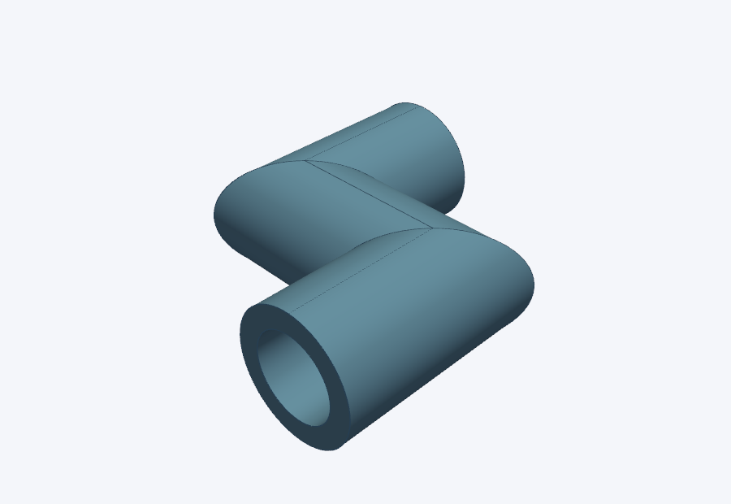

# solidfunc

[](https://pypi.org/project/solidfunc/)
[](https://pypi.org/project/solidfunc/)
[](https://github.com/DavidMStraub/solidfunc/actions/workflows/ci.yml)
[](https://github.com/DavidMStraub/solidfunc/blob/main/LICENSE)
[](https://doi.org/10.5281/zenodo.24395927)

solidfunc is a typed, functional Python library for code-based CAD, built on
[SolidCore](https://github.com/tangency-labs/solidcore), a B-rep geometry
kernel written in Rust. You build solids from primitives and planar profiles,
place and combine them, select faces and edges, round and chamfer edges, and
export STEP files for use in other CAD tools.

## Install

```sh
pip install solidfunc
```

Wheels are available for Linux, macOS, and Windows on Python 3.11 and later.

## A first part

A plate with a hole whose rim is rounded, exported as STEP:

```python
import solidfunc as sf

plate = sf.box(size_x=80, size_y=50, size_z=10)
hole = sf.cylinder(diameter=20, height=10)
part = plate - hole

top = max(sf.faces(part), key=lambda face: face.centroid[2])
hole_edge = [edge for edge in sf.edges(top) if edge.kind == "circle"]
part = sf.fillet(part, hole_edge, radius=2.0)

print(f"{sf.volume(part):.3f} mm³")
sf.export_step(part, "plate.step")
```

Every operation returns a new value and leaves its inputs unchanged. Lengths
are in millimetres and angles in degrees. Selection is plain Python over
typed face and edge data. See the
[API reference](https://github.com/DavidMStraub/solidfunc/blob/main/API.md)
for signatures and conventions.

## Gallery

Parts from the chapters of
[CAD as Code](https://github.com/DavidMStraub/cad-as-code-book), rebuilt in
solidfunc.

| | |
|---|---|
|  |  |
| [**Clutch brick**](https://github.com/DavidMStraub/solidfunc/blob/main/examples/clutch_brick.py): studs placed on the top face with `place()` | [**Battery tray**](https://github.com/DavidMStraub/solidfunc/blob/main/examples/battery_tray.py): cell pockets, mirrored holes, and a lead-in round selected by radius |
|  |  |
| [**Swept elbow**](https://github.com/DavidMStraub/solidfunc/blob/main/examples/swept_elbow.py): a hollow section swept along a cornered path | [**Duct**](https://github.com/DavidMStraub/solidfunc/blob/main/examples/duct.py): a loft from a circle to a rectangle |

## Viewing parts

Install [PyVista](https://github.com/pyvista/pyvista) with `pip install pyvista`,
then call `show()`:

```python
from solidfunc.view import show

show(part)
```

Pass `screenshot="part.png"` to save a PNG. In Jupyter, `show()` displays a
static preview by default. For an interactive view, install `pyvista[jupyter]`
and pass `jupyter_backend="client"`.

## About this project

### Motivation

The best-known open-source code-CAD libraries for Python,
[CadQuery](https://github.com/CadQuery/cadquery) and
[build123d](https://github.com/gumyr/build123d), are built on the
[OpenCascade Technology (OCCT)](https://github.com/Open-Cascade-SAS/OCCT)
kernel. SolidCore started as a Rust port of SMLib, the NURBS B-rep kernel
that NVIDIA published as part of
[USD BRep](https://github.com/NVIDIA-Omniverse/usd-brep), and has diverged
from it since. solidfunc asks how much of a parametric code-CAD API depends
on its kernel, and which of its ideas are properties of OCCT rather than of
code-CAD in general.

### Scope

solidfunc is a small academic experiment, not a replacement for CadQuery or
build123d. For real work, use one of them. My book
[CAD as Code](https://github.com/DavidMStraub/cad-as-code-book) uses
CadQuery's functional API throughout, and the first part above comes from
[chapter 2](https://github.com/DavidMStraub/cad-as-code-book/blob/main/chapters/ch02-first-parts.md).
solidfunc borrows many ideas from CadQuery and build123d.

### Findings

- SolidCore builds solids from geometric sketch records (segments, loops,
  regions), not from OCCT's topological edges and wires. solidfunc's
  `Curve2D`, `Path2D`, and `Profile` mirror those records, and topology
  (`Face`, `Edge`, `Vertex`) only exists inside a solid.
- SolidCore stores a round on a straight edge as a cone with a zero
  half-angle, and `revolve` produces B-spline surfaces even for a cone or a
  sphere. solidfunc reports the first as a cylinder and documents the
  second, so selection by surface type depends on how the kernel stores
  surfaces.
- SolidCore's booleans consume their operands, so solidfunc copies its
  inputs to keep every value unchanged.
- SolidCore unites many bodies in one call, which became `union(*shapes)`.

### Coverage

solidfunc builds single solids from primitives, extrusions, revolutions,
lofts, and sweeps, with booleans, placement, fillets and chamfers, face and
edge queries, and STEP import and export. Assemblies, colours, open sheets
and shells, and 2D operations on profiles are outside its scope. Releases
are alphas, and the API can change between them.

## Development

The repository includes a [dev container](https://containers.dev/) in
`.devcontainer/` with the pinned Python and Rust toolchains, uv, and the
OCP CAD Viewer extension. Opening the repository in it builds solidfunc
and installs CadQuery for the STEP exchange tests.

To build from source without it, install [uv](https://docs.astral.sh/uv/) and
[Rust](https://rustup.rs/), then run from the cloned repository:

```sh
uv sync --locked --config-setting build-args=--profile=dev
uv run --no-sync pytest
uv run --no-sync python examples/hello_world.py
```

`examples/render_gallery.py` regenerates the gallery images.

## Citing

If you use solidfunc in your work, please cite it; GitHub's "Cite this
repository" button gives the reference from
[CITATION.cff](https://github.com/DavidMStraub/solidfunc/blob/main/CITATION.cff).

## License

solidfunc is MIT licensed. SolidCore and the SMLib code it derives from
([USD BRep](https://github.com/NVIDIA-Omniverse/usd-brep)) are Apache-2.0
licensed. The distribution includes the corresponding upstream notices.
solidfunc is not affiliated with or endorsed by NVIDIA.
