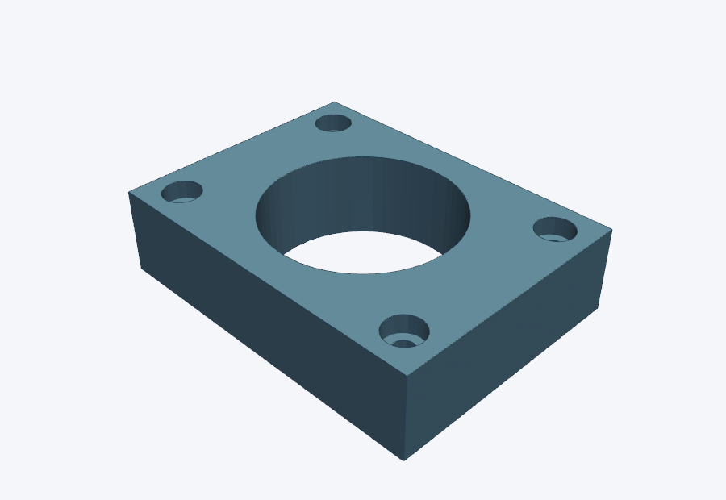

# solidfunc

An experimental, typed, functional Python API for
[SolidCore](https://github.com/tangency-labs/solidcore). Build 3D solids from
primitives and planar profiles, transform and combine them, and export STEP.
This small academic project explores ideas from
[CadQuery](https://github.com/CadQuery/cadquery),
[build123d](https://github.com/gumyr/build123d), and
[CAD as Code](https://github.com/DavidMStraub/cad-as-code-book).

## Quickstart

To build from source, install [uv](https://docs.astral.sh/uv/) and
[Rust](https://rustup.rs/), then run these commands from the cloned repository.
solidfunc supports Python 3.11 and later.

```sh
uv sync --locked --config-setting build-args=--profile=dev
uv run --no-sync python examples/hello_world.py
```

To make your own part, save and run a Python script like this in that environment.

```python
import solidfunc as sf

block = sf.box(size_x=10, size_y=20, size_z=30)
moved = sf.translate(block, x=100)
sf.export_step(moved, "block.step")
```

Lengths are in millimetres. Operations preserve their inputs, and the exported
STEP AP242 file opens in CAD tools.

See the [API reference](API.md) for signatures, units, and geometry conventions.

## Viewing parts

Install PyVista separately with `pip install pyvista` in the same environment,
then call `show()` with a solidfunc shape.

```python
from solidfunc.view import show

show(moved)
```

Pass `screenshot="part.png"` to save a PNG. In Jupyter, `show()` displays a
static preview by default. For an interactive view, install `pyvista[jupyter]`
and pass `jupyter_backend="client"`.



[Source for the bearing pillow block](examples/bearing_pillow_block.py)

## License

solidfunc is MIT licensed. SolidCore and its SMLib-derived code are Apache-2.0
licensed. The distribution includes the corresponding upstream notices.
